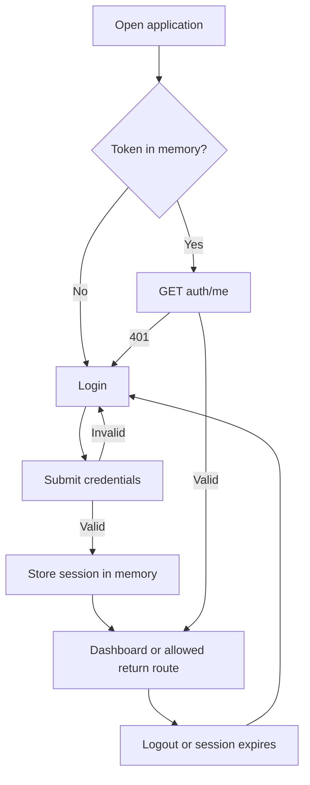
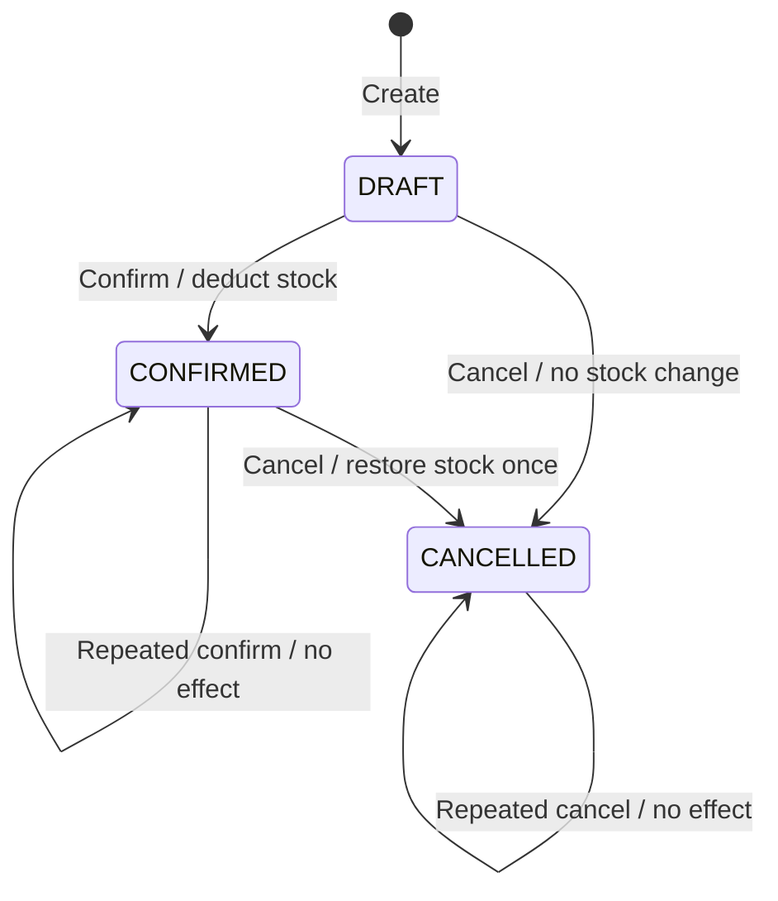

# StockFlow — Application Flow

Status: Planned | Date: 2026-10-13

Related: [PRD](PRD.md), [TRD](TRD.md), [Design brief](DESIGN_BRIEF.md).

## 1. Navigation and routes

| Route | Screen | Access |
|---|---|---|
| `/login` | Login | Public |
| `/dashboard` | Overview | Admin, staff |
| `/products` | Searchable product list | Admin, staff |
| `/products/new` | Create product | Admin |
| `/products/:id` | Product detail and movement history | Admin, staff |
| `/products/:id/edit` | Edit catalogue fields | Admin |
| `/suppliers` | Supplier list | Admin, staff |
| `/suppliers/new` | Create supplier | Admin |
| `/suppliers/:id` | Supplier detail and linked products | Admin, staff |
| `/suppliers/:id/edit` | Edit supplier | Admin |
| `/orders` | Order list | Admin, staff |
| `/orders/new` | New draft form | Admin, staff |
| `/orders/:id` | Order detail and state actions | Admin, staff |
| `/users` | Account management | Admin |

Root `/` redirects to dashboard if authenticated, otherwise login. Unknown routes show a not-found page. Sidebar items: Dashboard, Products, Suppliers, Orders, and admin-only Users. Account menu shows email, role, and Logout. Stock forms appear in product detail dialogs; user creation/editing uses dialogs on Users.

## 2. Session flow

Preserve only a safe internal return URL, not form passwords or tokens. A 403 shows an access-denied state without logging the user out. On login failures show a generic message; on 429 show retry guidance. Reload loses the in-memory session by design. Session expiration warns that unsaved work may need re-entry; passwords are never persisted.

## 3. Admin onboarding journey

1. Provision initial admin through the documented bootstrap command.
2. Log in, see an empty dashboard with “Add your first product”.
3. Optionally create a supplier.
4. Create a product with price and low-stock threshold; initial stock is zero.
5. Open product detail and record a stock receipt.
6. Create staff accounts through Users.
7. Create and confirm a sample order; verify stock and dashboard metrics.

Each empty state links to the next permitted action. Staff empty states explain that an admin must add catalogue/inventory data.

## 4. Product and supplier flow

### Browse

Products -> search/filter/paginate -> product detail -> movement history. Preserve filters when returning to the list. Show active products by default and offer an archived/all filter.

### Create/edit

Admin opens form -> enters allowed fields -> client checks required fields -> POST/PATCH -> field errors or saved detail screen. Supplier selection contains active suppliers only; an already linked archived supplier remains labelled in an edit form until replaced/cleared. Stock is read-only on the product form.

### Archive

Detail -> Archive -> confirmation explains that draft orders containing this product cannot be confirmed -> PATCH active=false -> refresh detail/list. Archived records retain their history. The MVP does not provide unarchive actions. Supplier archiving does not archive its products.

## 5. Inventory flow

Product detail -> admin selects “Receive stock” or “Adjust stock”.

| Action | Inputs | Outcome |
|---|---|---|
| Receive | Positive quantity, optional reference | Positive receipt movement |
| Adjust | Nonzero signed quantity, required reason, optional reference | Signed adjustment movement |

Display current stock and an estimated resulting balance before submission. The server validates against the latest balance. On success, refresh product, history, and dashboard. On insufficient stock, show the conflict and refresh availability; preserve entered values for correction. Manual changes to archived products are unavailable. Cancellation may still restore their stock automatically.

If the request times out after submission, say “We could not confirm the result. Check stock history before retrying.” Do not automatically send a second movement.

## 6. Order creation flow

Orders -> New order -> optionally enter customer/reference -> search active products -> add items -> enter positive integer quantities -> preview -> Create draft -> order detail.

- Prevent duplicate product rows; adjusting an existing row changes its quantity.
- Display current availability for context, but permit drafts exceeding stock because drafts do not reserve inventory.
- Label preview prices as estimates until the server returns the snapshots and total.
- After creation, items are immutable. To correct a draft, cancel it and create a new order.
- On creation validation errors, preserve the form and focus the first error.
- On an ambiguous network result, ask the user to inspect recent orders before creating another draft.

## 7. Order lifecycle

### Confirm

Draft detail -> Confirm order -> explain total and stock deduction -> POST confirm -> updated confirmed detail. If stock is insufficient or a product was archived, retain draft state, show the server error, and refresh product data. A cancelled order cannot be confirmed.

### Cancel

Draft/confirmed detail -> Cancel order -> confirmation dialog. Draft message: “This draft will be cancelled. Stock will not change.” Confirmed message: “This order will be cancelled and its quantities returned to stock.” After success show cancelled status and timeline. Never show cancellation as deleting order history.

### State-dependent actions

| State | Visible actions |
|---|---|
| DRAFT | Confirm, Cancel |
| CONFIRMED | Cancel |
| CANCELLED | View only |

Disable actions while pending. If another user changes the order, refresh its state after a conflict. A `RESOURCE_BUSY` error may be retried after refresh; confirmations/cancellations are safe to repeat.

## 8. Dashboard flow

Show active products, low-stock products, draft orders, and confirmed order value. Clicking low stock opens `/products?lowStock=true`; clicking draft orders opens `/orders?status=DRAFT`. Recent order rows open details. Use independent loading/error states for summary, recent orders, and low-stock list so one failed request does not hide the whole screen.

## 9. User management

Admin -> Users -> Create account -> email, initial password, role -> success with no password echoed. Editing allows role and active status. Explain deactivation before submitting. Last-admin violations appear inline. If an admin changes their own access, refresh `/auth/me`; redirect to an allowed route or login as appropriate. Never display password hashes.

## 10. Shared state handling

| State | Behaviour |
|---|---|
| Loading | Skeleton or labelled progress indicator; retain layout |
| Empty dataset | Explain setup action appropriate to role |
| No matching results | Offer clear filters |
| 400 | Inline field errors plus summary |
| 401 | Clear session/cache and route to login |
| 403 | Access-denied panel with dashboard link |
| 404 | Resource-not-found panel with list link |
| 409 | Explain business conflict and refresh relevant data |
| Network/500 | Persistent error with safe retry where appropriate |

Warn before navigating away from dirty create/edit forms. Dialogs support Escape, focus trapping, and focus return. Successful mutations announce concise status feedback; important errors remain visible until resolved or dismissed.
