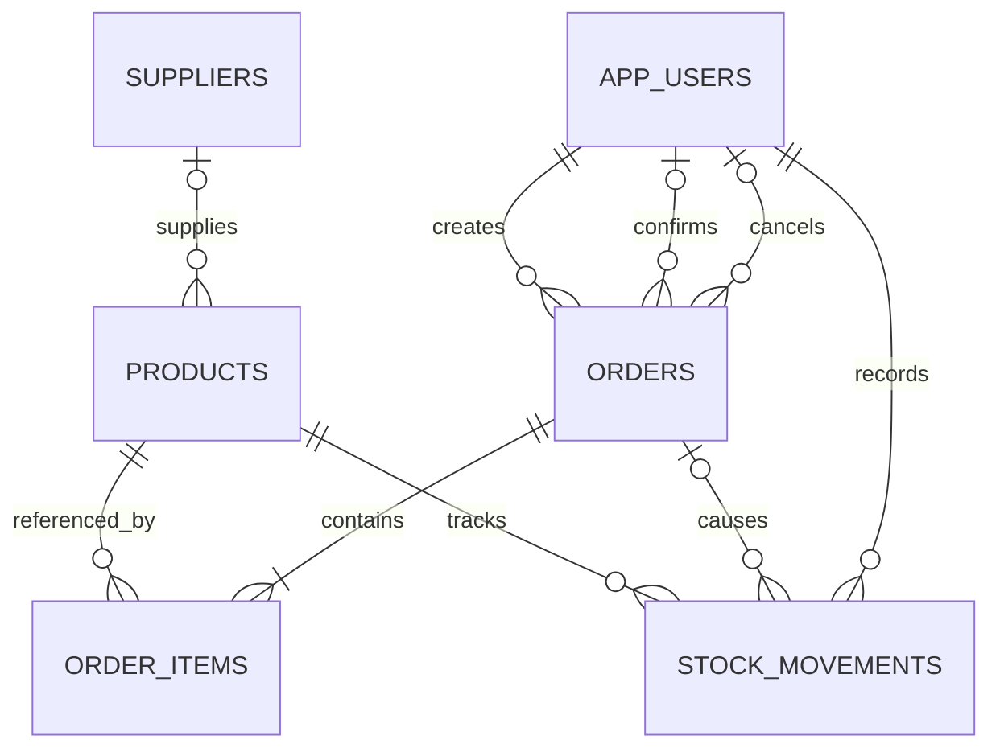

# StockFlow — Backend Schema

Status: Planned PostgreSQL schema | Date: 2026-10-13

Related: [PRD](PRD.md), [TRD](TRD.md). This specification guides Flyway migrations; it is not an applied migration.

## 1. Common conventions

- Tables/columns: snake_case. Java entities: singular PascalCase.
- IDs: application-generated UUID primary keys, NOT NULL.
- Timestamps: `timestamptz`, mapped to Java Instant; write UTC. `created_at` defaults to `now()`; services maintain `updated_at` where present.
- Every column is NOT NULL unless marked nullable below.
- Foreign keys use ON DELETE RESTRICT. No public hard-delete workflows.
- Use varchar plus CHECK constraints for enums; change allowed values through explicit migrations.
- All money uses NUMERIC and BigDecimal. API exposes decimal strings. No float/double money fields.
- Trim/normalize input before persistence. Reject blank required strings and excessive lengths.

## 2. Relationships

An order must have at least one item at the service layer; a simple foreign key cannot enforce that parent-side cardinality.

## 3. `app_users`

| Column | Type | Notes |
|---|---|---|
| id | uuid | PK |
| email | varchar(254) | Lowercase, trimmed, unique |
| password_hash | varchar(255) | BCrypt hash; never returned |
| role | varchar(16) | ADMIN or STAFF |
| active | boolean | Default true |
| created_at | timestamptz | Creation time |
| updated_at | timestamptz | Last change |

Constraints: unique email; `email = lower(btrim(email))`; nonblank email; role check. Email syntax is also validated by the application. Last-active-admin protection is transactional application logic under a shared advisory lock, not a row CHECK.

## 4. `suppliers`

| Column | Type | Notes |
|---|---|---|
| id | uuid | PK |
| name | varchar(160) | Nonblank |
| email | varchar(254) | Nullable |
| phone | varchar(32) | Nullable; string preserves country prefix |
| address | varchar(500) | Nullable |
| active | boolean | Default true |
| created_at | timestamptz | Creation time |
| updated_at | timestamptz | Last change |

Supplier names/emails are not unique business keys. Blank optional contact fields normalize to null. Archiving does not alter linked products.

## 5. `products`

| Column | Type | Notes |
|---|---|---|
| id | uuid | PK |
| sku | varchar(64) | Uppercase, trimmed, unique |
| name | varchar(160) | Nonblank |
| description | varchar(2000) | Nullable |
| unit_price | numeric(12,2) | Nonnegative |
| stock_quantity | integer | Default 0, nonnegative |
| low_stock_threshold | integer | Default 0, nonnegative |
| supplier_id | uuid | Nullable FK -> suppliers.id |
| active | boolean | Default true |
| created_at | timestamptz | Creation time |
| updated_at | timestamptz | Last change |

Constraints: unique normalized SKU; `sku = upper(btrim(sku))`; nonblank SKU/name; nonnegative price/stock/threshold. SKU accepts ASCII letters, digits, dot, underscore, and hyphen so application/database normalization is predictable.

Low-stock predicate: `active = true AND stock_quantity <= low_stock_threshold`. Stock must equal the sum of signed movements for that product, starting from zero. This cross-row invariant is maintained by transactions and verified through reconciliation queries/tests.

## 6. `orders`

| Column | Type | Notes |
|---|---|---|
| id | uuid | PK |
| order_number | varchar(32) | Unique human-readable identifier |
| customer_name | varchar(160) | Nullable |
| reference | varchar(160) | Nullable |
| status | varchar(16) | DRAFT, CONFIRMED, CANCELLED |
| currency | char(3) | Configured currency snapshot, initially LKR |
| total | numeric(24,2) | Nonnegative; sum of item totals |
| created_by | uuid | FK -> app_users.id |
| confirmed_by | uuid | Nullable FK -> app_users.id |
| cancelled_by | uuid | Nullable FK -> app_users.id |
| created_at | timestamptz | Creation time |
| confirmed_at | timestamptz | Nullable |
| cancelled_at | timestamptz | Nullable |

Generate order numbers from a database sequence, for example `SF-00000001`. Sequence gaps after rollback are expected; never use row count or MAX+1. Numeric width must expand rather than truncate when the counter grows.

State checks:

- DRAFT: all confirmation/cancellation actors and timestamps are null.
- CONFIRMED: confirmed_by/confirmed_at present; cancellation fields null.
- CANCELLED: cancelled_by/cancelled_at present; confirmation fields are either both null (cancelled draft) or both present (cancelled confirmed order).
- A confirmation/cancellation timestamp cannot precede creation; when both exist cancellation cannot precede confirmation.
- Total equals the item sum through service logic; immutable item snapshots prevent later catalogue changes from affecting totals.

## 7. `order_items`

| Column | Type | Notes |
|---|---|---|
| id | uuid | PK |
| order_id | uuid | FK -> orders.id |
| product_id | uuid | FK -> products.id |
| sku_snapshot | varchar(64) | SKU at draft creation |
| name_snapshot | varchar(160) | Name at draft creation |
| quantity | integer | 1–1,000,000 |
| unit_price_snapshot | numeric(12,2) | Nonnegative |
| line_total | numeric(24,2) | quantity × unit_price_snapshot |

Constraints: unique `(order_id, product_id)`; quantity bounds; nonnegative price; `line_total = quantity * unit_price_snapshot`. Order items are immutable after creation. Maximum 100 items per order is checked by the service. The wider total precision accommodates permitted quantities and order size.

## 8. `stock_movements`

| Column | Type | Notes |
|---|---|---|
| id | uuid | PK |
| product_id | uuid | FK -> products.id |
| type | varchar(24) | RECEIPT, ADJUSTMENT, ORDER_CONFIRMATION, ORDER_CANCELLATION |
| quantity_delta | integer | Nonzero signed value |
| reason | varchar(500) | Nullable except adjustment |
| reference | varchar(160) | Nullable |
| order_id | uuid | Nullable FK -> orders.id |
| created_by | uuid | FK -> app_users.id |
| created_at | timestamptz | Immutable event time |

Checks:

- RECEIPT: positive delta, order_id null.
- ADJUSTMENT: nonzero delta, nonblank reason, order_id null.
- ORDER_CONFIRMATION: negative delta, order_id present.
- ORDER_CANCELLATION: positive delta, order_id present.
- For order-driven movements, composite FK `(order_id, product_id)` references the unique pair on order_items; nullable order_id permits manual movements.
- Unique partial index `(order_id, product_id, type) WHERE order_id IS NOT NULL` prevents a second movement of the same effect for an order/product.

Do not add updated_at: movements are append-only. The runtime database role receives SELECT/INSERT but no UPDATE/DELETE on this table. The migration role remains separate. Application logic ensures movement magnitude matches order-item quantity and saves the movement together with its balance update.

Phase 4 implementation adds an append-only PostgreSQL trigger rejecting UPDATE/DELETE, alongside the immutable entity and restricted repository. Separate production runtime/migration role provisioning is still a deployment task; local Compose credentials remain unchanged. V4 refuses pre-existing nonzero balances that have no opening ledger, rather than silently rewriting data. Any such data needs a reviewed opening-balance migration.

## 9. Index plan

Primary keys and unique constraints already create indexes; avoid duplicating them.

| Table | Index | Purpose |
|---|---|---|
| products | `(supplier_id)` | Supplier product lookup/FK access |
| products | `(active, name, id)` | Default active catalogue sort |
| suppliers | `(active, name, id)` | Supplier list |
| orders | `(created_at DESC, id)` | Recent orders/date filter |
| orders | `(status, created_at DESC, id)` | Status-filtered order list |
| order_items | unique `(order_id, product_id)` | Item retrieval and duplicate prevention |
| order_items | `(product_id)` | Product history/FK access |
| stock_movements | `(product_id, created_at DESC, id)` | Product movement pagination |
| stock_movements | partial unique `(order_id, product_id, type)` | Exactly-once order effects |

At MVP scale, case-insensitive substring search may scan the catalogue. Examine EXPLAIN ANALYZE before adding trigram indexes/extensions. Add actor foreign-key indexes only when query patterns or administrative maintenance justify them.

## 10. Locking and invariants

- Order transitions: order row first, then product rows in ascending UUID order.
- All inventory writes and catalogue updates use the same product locking discipline.
- Supplier assignment locks referenced supplier rows after products and verifies activity; supplier archival does not acquire product locks.
- Last-admin updates use one well-defined transaction-scoped advisory lock.
- Database integer overflow, stock negativity, and numeric range failures must be prevented with validation and still roll back atomically if encountered.
- Cancellation retains historical confirmation metadata and restores quantities even when the product is archived.

## 11. Flyway migration plan

| Migration | Contents |
|---|---|
| `V1__create_users.sql` | app_users and user constraints |
| `V2__create_catalogue.sql` | suppliers, products, constraints and list indexes |
| `V3__create_orders.sql` | order-number sequence, orders, order_items and indexes |
| `V4__create_stock_movements.sql` | movement table, sign/type constraints, composite FK and indexes |

Bootstrap credentials and demo data do not belong in schema migrations. Seed inventory via the same receipt logic used by the application. Provision runtime/migration database privileges through deployment administration scripts. Once a migration is applied to a shared environment, add a new migration rather than editing its checksum/history.

## 12. Schema verification

- Apply all migrations to empty PostgreSQL in CI and validate JPA mappings.
- Verify uniqueness, enum/sign/state checks, and foreign keys with invalid writes.
- Test price snapshots after catalogue edits and archived references after cancellation.
- After stock workflows, assert balance equals movement sum and order total equals item sum.
- Run concurrency tests with real PostgreSQL and independent transactions.
- Document backup/restore before deploying future destructive migrations.
